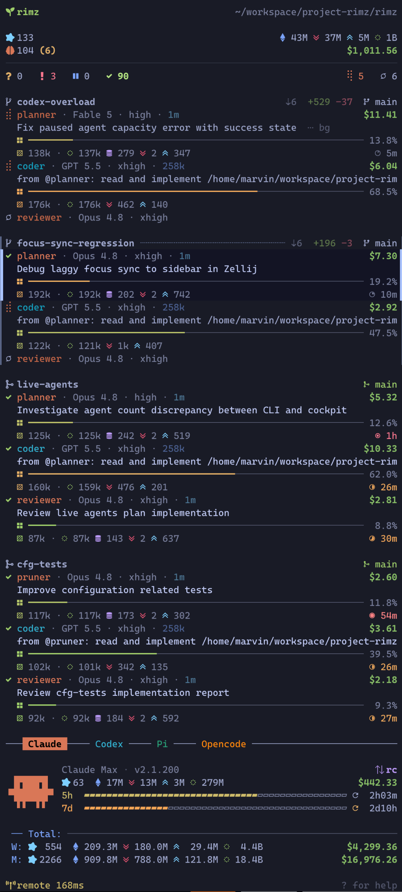
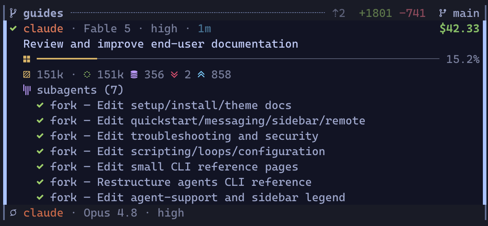

# Sidebar

<p align="center">
  
</p>

Running coding agents today means one conversation per terminal: prompt, watch it run, answer when it stops. Two agents fit in two tabs. Ten do not. Every rotation through the tabs costs a context switch for your head as much as for the terminal: re-read scrollback to tell *thinking* from *waiting on me*, reload what this agent was doing, then find your way back to your own work. Nothing announces a finished turn or a blocking question, so you learn about them whenever you next visit the tab, and until you do, an agent stopped on a permission prompt looks exactly like an agent reasoning.

The sidebar replaces the rotation with a column. One narrow pane beside the agents holds one live card per agent: its state, what it is working on, how full its context window is, what it has cost. A card changes as the agent starts a turn, calls a tool, asks a question, or finishes. One line counts the fleet by state, so a row of zeros means nothing needs you and you can stay where you are. When an agent does need you, its card rises to the top of its group and marks itself unread; press `n` and you are in that agent's pane. Checking becomes a glance, a switch starts with the card's context already read, and finished work waits marked instead of hoping to be noticed.

You never work *in* the sidebar. It has no reply box and no approve button. It routes you to the pane, and you answer in the agent's own UI, where the full prompt and its safe defaults live.

## Why you can trust it

**Agents report themselves.** The reporting hooks you approved when you [installed hooks](./setup.md#install-agent-hooks) fire from inside each agent: session start, tool call, blocking question, turn end. A card changes because the agent said so, and nothing on a card is read off the screen. The single exception is Codex, whose pane RimZ reads to confirm a turn that died. A few states are RimZ's own judgment rather than an agent report, and [the lifecycle](#the-agent-lifecycle) names them.

**The column reads; it does not drive.** It is one pane in your room running a renderer over the durable store those hooks write. Everything it writes is display: which cards you have read, its own heartbeat, and the status suffix on the mux tab names. Jumping focuses a pane exactly as your mux prefix would. Close the pane and every agent keeps working, `rimz sidebar repair` puts the column back, and a card that still needs you is still unread and still ranked when it returns.

RimZ does act on agents from behind the column, in one place for its configured hands-off automation: auto-continue resumes a parked agent, idle compaction condenses a resting agent's context, auto-redeem spends a reset credit, and a crossed budget cap parks the work ([keep the fleet moving](./loops.md#keep-the-fleet-moving), [budgets](./budget.md)). Nothing else in the column touches an agent.

A card exists because a pane runs right now, so when the agent exits its card goes with it. The history stays in the store, behind `rimz agents show`, `rimz agents logs`, and [`rimz transcript`](../reference/cli/agents.md).

If the sidebar cannot paint, the column shows the reason and a retry delay instead of incomplete cards. It retries automatically without closing your work panes. If the notice names a log file, read it for the startup error.

## The layout

Top to bottom, the column stacks three zones plus pinned chrome:

```
┌───────────────────────────────────────────┐
│ cockpit        the whole fleet summary    │  pinned
├───────────────────────────────────────────┤
│ cards          one card per pane,         │  scrolls
│                grouped by worktree        │
├───────────────────────────────────────────┤
│ provider       accounts, budget,          │  pinned
│                token stats, pets          │
├───────────────────────────────────────────┤
│ footer         help · link health         │  pinned
└───────────────────────────────────────────┘
```

The cockpit and the dashboard hold fixed positions, so the numbers you glance at never jump as agents change state; only the cards scroll between them.

### The cockpit

The top block reads the whole room in four lines:

- The first line names the workspace and its path, so a glance confirms which project this room is.
- The second counts the agent sessions that have run in the configured spend window, with the room's token breakdown pinned right: total, input, output, and cache-read.
- The third counts the agents alive right now and adds the open-PR count `⑃ N`, stacked PRs included. The room's dollar spend pins right, rolling up live as agents work, and the PR count turns red for failing CI, amber while CI runs, green when every known lane passes, and stays its plain self when CI is unknown.
- The fourth is the make-up line, work by state: a team within one worktree group counts once, and a solo agent counts once. Any teammate can add attention (`?` waiting, `!` failed, `⏸` paused). For a staged team, the stage owner decides whether work is running, sleeping, or idle; a board at `Done` counts as done. Without a usable stage owner, a team counts working first, otherwise sleeping, idle, or done. A calm bucket appears beside attention only while working. Only done excludes finished groups. A working team with idle teammates therefore reads `⢿ 1`, `○ 0`; `¤` still counts every agent.

A row of zeros in the attention buckets means nothing needs you, so you can skip the scan entirely. Every non-zero bucket is a click target that shows matching units in every tab of the room, including all their teammates. Shown cards look and act as without a filter, and selection keys reach every shown card. Picking a filter keeps your selection if that card is still shown. Clearing or replacing the filter in one tab updates them all. `⑃ N` filters to open-PR groups; `u` shows unread cards. When the card that most needs you scrolls out of view, an `↑ N need you` or `↓ N need you` banner counts units with unread questions or failures and points toward that card; click it to reveal the card where it sits, without changing the selection or rearranging the frozen cards. If your filter hides it, the arrow points up and the click scrolls to the top instead. The exact [counting and filtering rules](../interface/sidebar.md#the-make-up-line) explain mixed teams.

When you know which work you want rather than which state needs you, press `Alt+p`, then `/auth` and `Enter` to focus the first matching pane. Search narrows the cards as you type; `↓` or `Ctrl+n` selects another match before `Enter`. For a quick jump without keeping the search, click a matching card while still typing instead. The committed `/ auth` chip stays on its own line above the dashboard in every tab, so `j` and `k` browse the matches and `n` still jumps to a matching card that needs you. A state filter such as `w` narrows those matches further. Clear the search with `Esc`, or press `A` to clear both the search and the state filter. Matching and editing rules are in [Text search](../interface/sidebar.md#text-search).

Every figure in this block, and how each one is counted, is [Token Insight](./insight.md#per-room-the-cockpit).

### The agent cards

The body holds one card per pane, grouped under the worktree it runs in. A worktree is a separate checkout on its own branch, so a group is one **line of work**, and that is the unit the column triages. [The ranking below](#how-the-column-is-ordered) decides the order of the cards inside a group and the order of the groups themselves.

The group header names the work and carries its git story on the right: commits ahead of and behind the trunk, lines added and removed (uncommitted and untracked work counts too), and one marker for where the work stands, from a plain branch through an open, merge-queued, merged, or closed pull request. A linked pull request puts its number on the left (`#91`) with its CI verdict beside it, and the badge opens that pull request in terminals that support hyperlinks. To see where your branch sits in stacked work, GitHub and Gitea stacks show same-repository PRs bottom first (`#522→#530`), each number opening its own PR. If several PRs branch from one level, commas join them and the stack stops there. When the whole stack cannot fit beside the full name and CI, the header keeps only your branch's own PR badge. A group running a named team carries `· forge` on its header. Every marker and what it means is in the [interface reference](../interface/sidebar.md#worktree-headers).

A team that hands work along declared stages keeps its progress on a board in the worktree ([teams](./teams.md#hand-off-with-one-command)), and the sidebar draws that board as a pipeline line directly below the group header: the team name first, then green `●` for passed stages, `◉` followed by the current stage name and its duration, and muted `○` for those ahead. The run total alone pins right, so `Implement 4h12m` beside `4h51m` separates the stage from the whole run. Both durations are plain and muted: one unit below an hour, two from an hour up. The stage time accumulates across visits, resuming when a flip returns to it; a yellow hollow dot marks a stage the team was sent back from; at `Done` only the frozen run total remains. Click the line to reach the stage owner. The line itself adds no attention. If an unfinished stage has an owner and every teammate stays idle or done for the stall window, the owner's card raises `!` with `stage Implement: nothing running 30m`, including the usual unread and notification behaviour. Member activity or a stage flip restarts that window; a sleeping or working member, or attention from a member's current child, prevents it.

A line of work is finished when its pull request merged or closed, or the trunk already contains it, its tree is clean, and nobody in it is working or blocked. Finished groups gather behind the landed chip, `[ ▸ N landed ]`, closed at first; click anywhere on its line to show their receipts, scrolling just enough to show the first receipt it reveals while keeping the chip on screen, and click `[ ▾ N landed ]` to hide them again. Every finished group with an agent collapses to its header and a receipt: who worked and what they cost in dollars, with tokens and time beneath when available. A single agent reads as its status and handle, with its cost on the right. Clicking the folded header or either receipt line opens the cards and takes you to the first member's live pane, bringing its card into view. The expanded header only collapses the cards without moving focus. A group with only process rows stays open, as does a group whose cards you have focused or opened. A filter or search hides the landed chip and shows matching cards directly; `s` excludes finished groups. The receipt's shape is drawn in [the interface reference](../interface/sidebar.md#row-cap-and-finished-groups), and its cost and tokens cover the sessions of this worktree's current life, counted the way [Token Insight](./insight.md#how-the-numbers-are-calculated) explains; until those totals arrive, the receipt shows the current sessions' costs.

Panes outside every project checkout fold into a dim `external` divider at the very bottom, which keeps its own `? n` and `! n` tally so an ask from outside the project still surfaces.

### The provider dashboard

Budgets belong to an account, so they live in a pinned panel at the bottom rather than on the cards. Each provider block names the account and plan (`Claude Max 20x`, `ChatGPT Pro 200`), titles itself with a [named account's](./accounts.md#declare-an-account) display label when valid or its name otherwise (`Claude · work`), and drains its budget-window bars toward their resets, so a glance reads how much of the plan is left. The block also carries that provider's spend, and totals rows below sum this machine's whole fleet across the trailing week and month.

Three or more providers share the panel under a tab rail, which follows the provider of whichever card you have selected; `←`, `→`, or a click picks one by hand. One or two providers stack instead. With [pets enabled](./pets.md), the companion rides the panel's right edge.

Codex budget windows refresh at turn boundaries and every five minutes between turns. Card metadata refreshes at turn boundaries; `rimz agents refresh @handle` requests an update sooner.

Reading these figures, and how every one is calculated, is [Token Insight](./insight.md#per-account-the-provider-dashboard). What a full, spent, ticked, or dim bar is telling you is in the [interface reference](../interface/sidebar.md#budget-bars).

If Claude Code subscription access is refused while you are still logged in, the plan label and bars disappear. One bold alarm row replaces them: `plan lapsed · no Claude access · since …`. The time is when RimZ first saw the refusal, not a renewal date. Restore Claude Code access with the provider, then run `rimz accounts show claude --refresh`; a successful usage read clears the lapse.

### Bottom chrome

The footer holds `? for help`, which opens the key and filter overlay in place. Search lives on its own line above the dashboard, banded with a cursor while typing and a chip after `Enter`, with a match count at the right. When you have been away from the keyboard, a quiet `zᶻ idle` badge appears in the footer; over SSH, a link-health badge shows the round-trip time. If the sidebar ever cannot read the room, a sticky alert takes the bottom line and says so, because a blank column should never masquerade as an empty room.

### Setting the width

The column sizes itself against its view: 30% on views wider than 240 columns or when pets are enabled, 25% otherwise, capped by `[theme.display].max_cols` and never narrower than 24 columns. Set a fixed share with `[theme.display].width_percent`, which is clamped to 10% through `[theme.display].max_percent`. The latter defaults to 50% and bounds user-selected widths too; its supported range is 10-90%. On narrow views the 24-column minimum wins ([theming: display](./theme.md#display)).

Press `a` to make it narrower or `d` to make it wider; hold either to keep resizing. The sidebar follows your presses without queuing a long resize after release; Zellij can finish one native step. Your choice is saved after 300 ms without another width press, then the other tabs follow. Dragging the pane border to a settled width also sets the room-wide share. A share you set this way outranks both the configured percentage and `max_cols`, but never `max_percent`. It holds its proportion through terminal resizes, reloads, and reattaches for the life of the session, and a newly created session starts again from the configuration. tmux takes the selected column exactly; Zellij resizes in fixed steps, so a tab parks within half a step of the share rather than on it. Both keys are rebindable under `[sidebar.keys]` ([configuration](./configuration.md#sidebar-rendering)).

A previously saved width above `max_percent` is reduced to the cap on reload, not restored to an earlier width. Press `a` to narrow it further.

## The agent card

<p align="center">
  
  <br/><sub>A finished card with the subagents it fanned out this turn; the idle agent below collapses to a single line.</sub>
</p>

Each engaged agent is a small stacked card, three lines at rest plus a shared line for subagents and pending waits:

```
⣾ claude · Opus 4.8 · high · 200k                $1.27    ← state · identity · cost
  store refactor                                          ← what it is working on
  ▣ ━━━━━━━━━━━━╺━╺─────────────────────── 38.2% ◔  7m    ← context meter · own quiet age
  ⧉ subagents (2) · ⧖ waits (2)                   $0.42    ← children · pending waits · what the children cost
```

The identity line leads with the state glyph, animated while the agent works, then the agent's handle (its team role, name, or profile, so a team reads `planner` / `coder` / `reviewer`), the model, its reasoning setting (an effort level such as `xhigh`, or `thinking`), and the size of its context window. When it fits without shortening the handle, a fast-mode model wears a bold amber bolt immediately after its name (`ϟ`, or the Nerd Font bolt): still at rest, crackling only while running. The provider's live reading wins over the launch setting; without a live reading, a fast launch supplies the badge. The session's dollar cost pins right once it rounds to a cent, counts up live, and already includes what the children it launched through `rimz subagents` spent.

A `↪` beside the model means [tier routing](./configuration.md#model-tiers) passed over an earlier model because it could not build the definition or its account was unavailable. Run `rimz agents show @<handle>` to see the tier and every reason. The marker disappears with the model on narrow panes.

The second line says what the session is on: its name or task, falling back to its first prompt so the card stays stable between turns, with a provider-supplied title taking over as soon as one is available. While waiting for an answer, it leads with the question instead when one is available, wrapping over at most two lines so you can read more before switching panes. When a turn fails or pauses on a provider error, this line quotes the reason in italics (`API Error: Overloaded`), so the card says why without a jump. A working-through-wait card names its first working wait; a sleeping card names its first sleeping wait when no error reason is present.

The context meter is how full the agent's context window is, as a bar and a percentage. The fill also shows where the window went, painting cache reads, cache writes, and fresh input as distinct runs, and its tone shifts from calm toward red as the window fills. An expired prompt cache instead wears one solid greyed-red run: waking that agent re-reads the whole window at full price. The fraction and percentage stay the same, and the `▣` glyph takes the same expired-cache tone. When a compaction finishes, the meter drops to the size the agent reports for its compacted context, or to an empty 0% when the agent reports none, and fills again from the agent's next model call.

At 46 columns or wider, every meter reserves the same right-hand age slot, blank until the agent has been quiet for five minutes. Below 46 columns the bar keeps that room, and the age pins right on the selected card's stats line instead. The clock face fills over the provider's prompt-cache lifetime, staying muted until the [cache warning band](../interface/sidebar.md#the-card), then warming from yellow through orange to red. For Claude's one-hour cache, that warning starts after 30 minutes. Past that lifetime the clock switches to the ringed `◉` face and turns greyed red along with the meter: the cache has already expired. When no lifetime is known, the clock fills over an hour and stays muted throughout; the meter does not guess at expiry. A keep-warm hold stays steady green and keeps the meter's usual segments. That age is the agent's own quiet time, restarted by a cache ping, so an agent waiting on its subagents keeps counting: its own session is making no call, and its context will be re-read when it resumes.

Select an engaged card to see its stats line below the meter. A previously selected card held open to prevent a jump keeps it too, and `expanded` density shows it on every engaged card. `▤` is the tokens in the window right now, then the same total split into cache reads, cache writes, input, and output, a `↻ N` count of completed context compactions, and an amber `⟲ N` once a running agent has repeated one tool call with identical arguments three times.

Wherever a card shows its stats, it adds a cache line below them when there is time to save the cache: `◷ cache expires in 8m` once the warning starts, warming with the clock. Once expired, it reads `◉ cache expired · ◍ ~$1.40 to re-warm`, so you can judge the cost of resuming. The estimate rounds to two significant figures, keeps cents below $10, and disappears when unpriced or below half a cent. Narrow sidebars shorten these to `◷ expires in 8m` and `◉ expired · ◍ ~$1.40`. Calm caches, keep-warm holds, and unknown lifetimes add no line. Held previous selections keep the notice, and `expanded` density shows it on every engaged card, teammates included.

The subagents and waits line appears once the session has spawned a child or armed a wait, and either count shows alone when only one applies. Idle and done cards hide it until selected, held open, or explicitly opened; `expanded` density keeps it everywhere. In `compact` density, select the card first. The subagent count is the session's lifetime children, for as long as RimZ retains its history, with their known cost pinned right. That cost is a breakdown of the identity line's figure rather than a second charge to add to it.

Read idle and done cards quiet for more than 24 hours shrink to one line: state, handle, description, cost, and age, the age tinted like the meter's clock. Selecting one restores it, as does holding it open or having clicked its subagents and waits line open. Selecting a teammate leaves it unchanged. Unread cards and agents still working or needing attention never shrink. Tune `[theme.display] stale_after_secs` in seconds, or set it to `0` to disable shrinking; `expanded` density keeps every card open.

A launched child stopped on a provider limit or overload shows paused with the error's label in its expanded entry, alongside the running children. Unless the parent is itself waiting on you, paused, or failed, its card follows the child's park: paused with `@child: label` on the second line, or failed once that pause can no longer resume automatically. The child entry changes to failed too. The label names the child so you can go to its pane rather than prompting the parent to continue.

To check delegated work, click the subagents and waits line to open its entries under the card and go to the parent's live pane; selecting the card opens them too, and your click sticks until you close it again. When you select another card, the previous card stays open until the layout freeze expires, even when you scroll, jump to unread, or toggle a section. Your explicit section toggles still apply immediately. Each subagent entry carries its own live state, its type in the color of the provider running it (a Codex child under a Claude parent reads as Codex), what the parent asked it to do, tokens, model, effort when reported, and runtime. A child launched through `rimz subagents` in fast mode wears the bold amber bolt after its effort (after its model when it has no effort), still in every state, when the line has room; native children never show it. A child that compacted its context restarts its `▤` window figure at the smaller size, so its second line adds `↻ N`, the completed compactions, after the model, effort, and any fast-mode bolt when the line has room; a Copilot native child never reports one. Runtime is plain and muted, frozen at the last activity once the child finishes, including on line 1 when there is no metadata. A running child quiet for five minutes shows a face and quiet age instead, heating to alarm at the configured stall threshold and staying there if stalled. A parked or waiting child keeps plain muted runtime; a parked child's runtime keeps counting until it fails. Running children lead in the order they started, then the children that finished recently, newest first; the rest fold behind a `+K older` line you can click to append and return to the parent's live pane. How long a finished child stays listed, and how many, are `recent_subagent_secs` and `max_recent_subagents` ([theming: display](./theme.md#display)).

A child launched with `rimz subagents` also shows its launch profile and its own session cost, and it has a pane and a transcript of its own. An interactive child's pane normally stays open until its parent ends the turn that received the result, leaving room for a follow-up; one-shot providers close on exit, and `--keep` holds the pane until its parent ends or Ctrl-C is pressed in the pane. The parent can also [message an ended child to resume it](../reference/cli/subagents.md#follow-up-messages). A provider's native subagents are headless. Either kind stays nested under its parent rather than becoming a duplicate top-level card. Selecting a team member opens only its own card; teammates' shapes stay unchanged, even while that card is later held open. The selection spines stay on the card you selected. Never-prompted unselected and held cards stay quiet at identity plus any launch description; only the live-selected fresh card shows its empty meter and, when unlabeled, compose dots.

Click either line of a launched child's entry to go straight to its live pane, even on another tab. A current waiting child also counts its parent in the cockpit's `?` bucket, without changing the parent's displayed status or lead glyph. If the parent is neither waiting nor failed, the `n`/`N`/`Space` walk goes to the first waiting launched child's live pane in entry order, falling back to the parent when none has a pane. The selection band stays on the parent card, and `▌` beside both entry lines marks the focused child while that card is selected. If you close the section, only the parent band remains. An entry with no live pane still takes you to the parent; clicking does not resume an ended child. Focusing a child does not mark the parent read; the parent clears as any card does, when you focus it or stay on a tab that shows its pane.

The `⧖` count covers armed one-shot waits (timers, existing processes, watched shell commands, one-shot signals) plus the shell commands a Claude agent left running in the background. It shares the subagents line, stays visible while the agent works as well as while it sleeps, and disappears when nothing is pending. Open the line and each wait lists beneath the subagent entries, naming its kind before the headline: `◷ timer · in 12m` for a timer, `⌁ signal · pr.merged` for a signal hold. Commands, checks, and background shells lead with a spinner and show the full command on a second line when known. The time on the right is how long each has been pending. See the [entry table](../interface/sidebar.md#subagents-and-waits) for every kind.

How much of the card shows at rest is yours to tune with `card_density` ([theming: display](./theme.md#display)): `compact` trims resting cards, including the shared subagents and waits line, and `expanded` keeps every engaged card's stats line and opens subagent and wait entries everywhere. In compact mode, select the card first to expose the clickable count line.

## Process rows

A pane no agent has claimed (your editor, a shell, a build) renders as a slimmer, quieter row: the program's name, a hollow `○` when idle, a spinner while it does real work, and, for a working pane, its live command plus a CPU, memory, and I/O readout. Process rows sit below the agent cards in their worktree, never enter the cockpit tallies, and never join the jump queue. A process stuck in uninterruptible sleep or left as a zombie does wear `!`, which flags a wedged process rather than a failed turn. Rows are still jump targets, and the moment an agent starts in that pane the row becomes that agent's card.

## The agent lifecycle

Every card wears one state, and seven cover the life of a session:

| glyph | state | meaning | needs you |
|-------|-------|---------|-----------|
| `○` | idle | alive, nothing in flight | no |
| `⢿` | running | working a turn, waiting on in-flight work, or running a background shell | no |
| `?` | waiting | stopped mid-task for your answer: a permission, a plan approval, a question | **yes** |
| `!` | failed | the turn errored, died on a provider API error, or tripped one of RimZ's safety nets | **yes** |
| `⏸` | paused | stopped mid-turn on a provider rate limit or overload; the description quotes the reason | when it recovers |
| `✓` | done | the turn finished cleanly and holds a result | a look, when convenient |
| `☾` | sleeping | resting on a timer, signal, condition, or file watch, including through a child; the description names the wait | nothing yet |

The full glyph vocabulary, including the transient heads that ride over a running card (thinking before the first file edit, compacting, waiting on subagents, parked on background work), is the [interface legend](../interface/sidebar.md#reading-the-glyphs).

A session's life traces one loop through those states:

```
 ●──launch──► idle ──prompt──► running ──┬── clean ──► done
                                 ▲   │   └── error ──► failed
                        answered │   │ asks you: permission,
                                 │   ▼ plan approval, question
                                 └─ waiting
```

- A fresh agent is **idle** until its first prompt; a prompt you type, or a queued `rimz message`, starts a turn.
- A **running** turn animates its head, and the head changes as the agent thinks, edits, compacts, or waits on its own children.
- An ask pulls the card to **waiting**, and answering it in the pane returns the agent to work; the card notices your answer before the turn formally moves on.
- A turn ends **done** or **failed**, and the state tells you whether to collect a result or unblock a problem.

RimZ also derives states rather than waiting for an agent to report one.

**Paused** keeps a card honest when the provider, not the agent, is the blocker. A turn that stops because the budget window is spent, the API is overloaded, or the connection dropped mid-response parks at `⏸` instead of reading as a failure, and with [auto-continue](./loops.md#keep-the-fleet-moving) enabled it resumes by itself once the window resets or the backoff clears.

**Failed** also covers two safety nets RimZ raises without a report: a running agent silent past the stall window (30 minutes by default), including any native or [launched child](./subagents.md#deadlines-stopping-and-cleanup), and a running agent that repeats one tool call with identical arguments 20 times, whose description then reads `loop: <tool> ×<count>` until a differing call clears the run. The same stall window covers a launched child given a task whose first turn has not started. A parent quietly waiting on its subagents is exempt from the stall check while a child is still displayed as working. A stalled native child also lifts the parent card's attention because it has no pane of its own. Either net can fire on an agent that is still executing, which is deliberate: silence that long, or a twentieth identical call, usually means something needs a look.

**Sleeping** means a resting agent awaits a timer, signal, condition, or file change, including through a child. Its card wears a static cool-toned moon and a description such as `wakes in 12m`. A [one-shot wait](./loops.md#wake-a-running-agent) for a PID, command, check, unfinished team, or working child instead keeps the card working, as does a listed background shell. A child resting on another wait follows that chain. A settled child's report does not keep work in flight. Sleeping cards rank below running and above idle; the `☾` bucket on the make-up line counts sleeping units, not individual teammates.

Working, waiting, failed, paused, and waiting on live subagents all take precedence over sleep, and a standing subscription does not make an agent sleep. You can message a sleeping agent now without canceling its future wait. Its last result can still be unread, but sleeping itself needs no answer and sends no notification.

**Hibernation** saves memory by default on a [supported Linux machine](./configuration.md#agent-hibernation). An unfocused idle or successful agent can freeze after the grace period when it owes no work, has no background commands, and has no foreign processes in its scope. Agents with remote control enabled or a keep-warm horizon holding their cache stay awake. Hibernation leaves the card's state and unread result unchanged; `rimz agents show` carries the freeze time and reclaimed memory.

Focusing a hibernating pane wakes it after about a second, or sooner when you type or click in it. Passing through does not wake it; card clicks, mux navigation, sidebar toggle, and pane zoom all use this dwell. Messages, answers, pane input, and commands naming a pane (such as `rimz pane focus`) wake it at once. RimZ also wakes it before interrupting, restarting, or closing it. An agent woken by a look and given no new turn freezes again about 10 seconds after you leave its pane; messages, answers, and targeted commands restart the full configured grace period. Waking may take seconds as memory comes back from swap; keys typed before thaw remain in the terminal queue and arrive when it wakes.

## Glance, jump, answer

The cockpit compresses the fleet into one line, and the column below arrives already triaged: the card that needs you next sits at the top of its group, a soft wash marks every result, ask, and recovery you have not seen, and the one card that most needs you animates across its glyph, name, and description until you read it.

You do not read where to go; you go. Press `n` (or `␣`) to jump to the next thing that needs you, oldest first, and RimZ focuses that agent's pane; `N` walks back. You read and answer there, in the agent's own UI, where the full context is. From any pane in the room, `Alt+p` focuses the sidebar, and pressing it again returns you to a work pane in that tab, so the whole loop runs without touching the mouse. The full key table is in the [interface reference](../interface/sidebar.md#keys-and-mouse).

Clicking a card selects it immediately while its pane gains focus; clicking a child selects its parent card. If you choose another pane before a jump finishes, the newer focus click or key cancels the pending jump, even when your new target is in the current tab. If the focus request fails, the highlight returns to session focus and a dismissable bottom notice reads `focus failed: <card>: <error>`. If cards move on their own, a click within 400 ms still targets the card you were looking at, or does nothing if it has left. Your next scroll, browse, or other action paints a new frame to click.

A card turns *unread* the moment it enters `waiting`, `failed`, `paused`, or `done`, and stays unread until you focus its pane, dwell a couple of seconds in its tab, or press `m`; `M` marks every card read. The mark survives the agent recovering and moving on, so a result you never looked at is still flagged an hour later. It changes emphasis, never position: the card keeps its place in the ranking while the wash, the blink, and the jump key get you to it. Sleeping opens no unread mark and sends no notification, and an earlier unread result stays unread across the sleep; the mark and any configured success notification arrive when the wait cycle finishes at done.

A card you have read stays read when its sidebar pane closes. Read state is shared across the room and retained until the card leaves.

The tab bar carries the same glance when the sidebar is off-screen. RimZ appends the most urgent work-unit glyph represented by the tab's panes to its existing name: `#feat !` for a failure, `#feat ?` for an ask, `#feat ⏸` for a provider pause, `#feat ⢿` while work is running, and `#feat ✓` for a clean finish in the last five minutes. Every teammate's pane reflects the team's verdict, even across tabs. The finish window starts at the board's `Done` flip for a completed staged team, or the latest member activity without a completed board (the solo agent's own activity). Without a recorded `Done` time, a completed board gets no `✓` suffix. Idle and sleeping tabs keep their bare names, and every mark except `✓` stays until the underlying state changes. The exact shapes and the naming rules behind them are in [the interface reference](../interface/sidebar.md#status-glyphs).

That loop is the product. When you are off-screen, desktop, bell, and command notifications carry the same cues, and handlers or loops you wire can clear routine prompts before they reach you ([notifications](./notifications.md), [loops and schedules](./loops.md)).

## How the column is ordered

With two agents you watch panes. With ten lines of work you cannot, and the sidebar is built for that day. At that scale the column has to be a triage list rather than a status dump, and every glance answers three questions: who is blocked on me, what has delivered and waits on my verdict, and is anything burning silently.

The third is the one no status dump answers, because a zombie run wears the same spinner as a healthy one. The column watches for you: a running agent silent past the stall window escalates to `!` and enters the work queue ([the lifecycle](#the-agent-lifecycle)), and a turn that dies on a provider error quotes the error on its own card, so quiet trouble surfaces in the same queue as loud trouble.

### What outranks what

Every row carries a weight from its state, and time scales it. By weight, heaviest first:

1. Asks (`?`) and failures (`!`) are blocked on you, and together they are your work queue. Every minute an ask waits idles a loaded context, a whole team's when the asker leads one, so they carry the most weight, climb for the first hour, then hold at the top until answered or the agent stops.
2. A parked card (`⏸`) is blocked on the provider rather than on you. There is nothing to answer until the limit recovers, and with [auto-continue](./loops.md#keep-the-fleet-moving) on, nothing to do at all.
3. A `done` card has delivered and waits on your verdict, so it leads the calm cards in its line of work: your review queue. That queue rots while it waits, because the trunk moves on and the group header's behind count (`⇣`) climbs, so the header tells you when a delivered branch is getting more expensive to land.
4. A running card is in flight and healthy. It needs nothing and wants a stable position so your eyes can track it, so it keeps a flat weight and holds its place, with live cost and last-activity age as the cheap progress cues.
5. An idle card is spare capacity, relevant only when you have work to hand out. It reads last, and a freshly launched agent appends at the bottom instead of reshuffling the list.
6. A merged or closed line of work with nobody running or blocked follows every unfinished group, even one that has archived with age, and folds behind the `landed` line.

These are weights rather than fixed tiers, and time scales them, so an hour-old park can outrank an ask from a minute ago.

### Time reshapes the order

Time is measured from each card's last activity, in three windows.

1. **Inside the first hour, blocked work climbs.** An ask, failure, or park grows more urgent the longer it waits, so blocked work reads roughly oldest-first, the cheapest order to clear, and a failure overdue fifty minutes outranks an ask from two minutes ago. Calm work keeps a flat weight, so live agents hold their place while they run. The hour is the default because a prompt after that much quiet usually re-reads the whole context uncached: answer inside it and the agent resumes warm.
2. **Between one hour and twenty-four, calm and parked cards cool.** Their weight decays with age instead of climbing, and the whole window sinks beneath anything currently hot. Recency starts to matter more than state here.
3. **Past twenty-four hours, a calm or parked card archives.** It parks at the back, keeping only its state order. This band is about age; it is unrelated to an agent sleeping on a wait.

Asks and failures are exempt from cooling and archiving while the agent is alive: an unanswered question still leads fresh running or idle work tomorrow.

A finished line of work with nobody running or blocked skips the clock and follows all unfinished work; a new run, ask, failure, or park revives it into the activity-ranked bands.

### Teams read as one

A co-launched team is one line of work, so it holds one contiguous block. The block takes its state from its members, first match winning: any member asking or failed makes it **blocked**, else a parked member makes it **paused**, else a running member makes it **working**, else a finished member makes it **done**, else it ranks with **idle**. Sleeping members count as calm rest here. One blocked member lifts the whole block, so a planner waiting on you blocks its coder and reviewer too, whatever they are doing. The block ranks on its heaviest blocked member and stays contiguous, so teammates sit side by side in their declared role order. The [`rimz teams` report](../reference/cli/teams.md#inspect-one-team) tells **sleeping** apart from working and idle, and a pending one-shot wait keeps a team from emitting `team.idle`.

### Activity decides among the calm

Attention always outranks git: a git-backed group with a blocked agent leads whatever its diff looks like. Among calm groups, activity answers *is this line moving?* first. **Working** groups lead, then groups holding a **finished** agent with nobody running, then idle agent groups, then process-only groups. Git refines groups at the same activity rung: **dirty** leads, **clean** follows, an unknown verdict follows clean, and **landed** sinks. Landed means a merged or closed pull request, or work the trunk already contains; a pristine fork stays clean rather than reading as landed work.

### What never moves

Three partitions hold regardless of any score, so the column keeps one stable outline:

- Agent cards lead their worktree and process rows form the tail, because shells, builds, and servers are context.
- Finished project groups follow every unfinished project group, behind the landed chip. Like `+K more`, the chip toggles by mouse only, and its open or closed choice follows your view between tabs. Opening scrolls only as far as the first receipt it reveals needs; neither opening nor closing changes the selection.
- Project worktrees lead and out-of-project panes tail, so the `external` divider always sorts last whatever it holds.

Inside an unfinished group, the six-row cap folds idle cards and process rows behind `+K more`; an agent card that is working, blocked, parked, finished, unread, or selected is never folded. After you jump or browse, the column freezes its order and keeps previously selected cards open for five seconds from your last interaction, so a glance back finds the cards where they were. The hold follows your view across tabs without restarting. Arriving without a hold freezes the last order you saw for the first frame. While any client sharing your view focuses its sidebar pane, the freeze lasts thirty seconds instead; leaving the pane restores the five-second deadline without restarting it. New cards appear at the end of their group, and new groups appear below the live groups. Content and read state keep updating; order, cap exemptions, and held cards settle together when the timer expires. A hidden view settles when it is next shown.

Switching tabs with the multiplexer's own keys moves the highlight without scrolling the cards. Your scroll, open cards and toggles travel with you to an unviewed sidebar. Clients viewing the same sidebar share what is on screen: joining another client's tab joins their view, and leaving takes a copy that can diverge. tmux clients always share one view; Zellij clients on different tabs can scroll independently. A departed client's view is kept for the [configured reattach window](./configuration.md#sidebar-rendering); a new client joins its pane's viewers or resumes the most recently active retained view, starting fresh only when none remains. The sidebar's own selection keys and jumps still bring an off-screen card into view. After an outside focus change, an off-screen card's name appears on the edge after a short pause. Click that marker to reveal the card without changing the selection.

## Tuning

Five `[agents.attention]` knobs move the boundaries: `stalled_after_secs` (a silent agent, native and launched children included, or an unfinished stage with nothing running escalates to `!`, 30 minutes), `tool_repeat_warn_after` (an identical-tool run gains `⟲`, 3 calls), `tool_repeat_attention_after` (that run escalates to `!`, 20 calls), `inactive_after_secs` (calm and parked cards cool, one hour), and `archive_after_secs` (those cards archive, 24 hours). Details in [configuration](./configuration.md#sidebar-rendering).

## See also

- [The sidebar on screen](../interface/sidebar.md): every glyph, meter, and frame drawn exactly, with the key table.
- [Token Insight](./insight.md): read the cockpit and provider-dashboard figures, `rimz stats`, and how the numbers are calculated.
- [Messaging](./messaging.md): the other half of the loop, reaching the agent the sidebar surfaced.
- [Notifications](./notifications.md): the same cues pushed to your desktop, phone, or a handler when you are off-screen.
- [Theming and pets](./theme.md): restyle the column, its palette, and the companion.
- [Remote](./remote.md): the link-health badge and the column rebuilt over SSH.
- [Configuration: sidebar rendering](./configuration.md#sidebar-rendering): the render cadence and attention knobs.
- [Sidebar internals](../internals/sidebar/sidebar.md): presence, the ranking contract, and reload.
