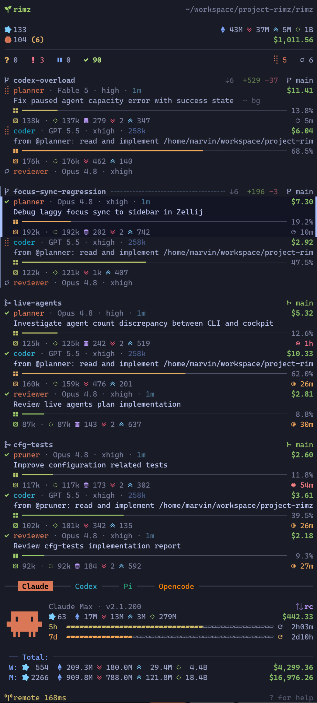
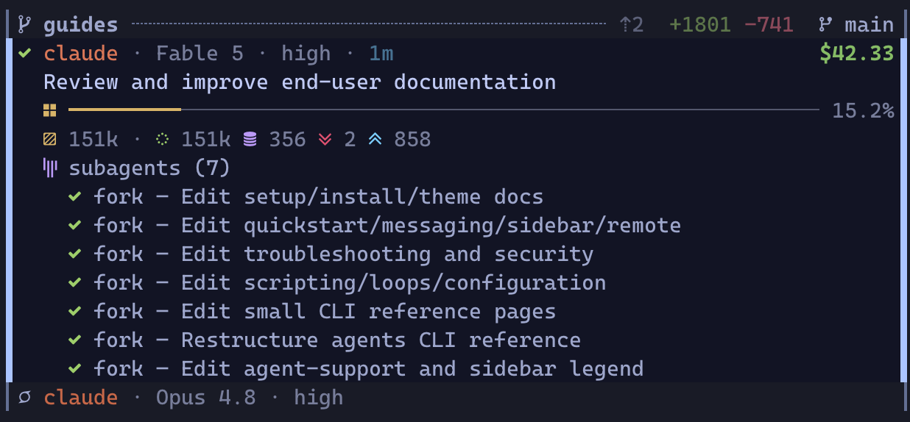

# Sidebar

<p align="center">
  
</p>

Running coding agents today means one conversation per terminal: prompt, watch it run, answer when it stops. Two agents fit in two tabs. Ten do not. Every rotation through the tabs costs a context switch for your head as much as for the terminal: re-read scrollback to tell *thinking* from *waiting on me*, reload what this agent was doing, then find your way back to your own work. Nothing announces a finished turn or a blocking question, so you learn about them whenever you next visit the tab, and until you do, an agent stopped on a permission prompt looks exactly like an agent reasoning.

The sidebar replaces the rotation with a column. One narrow pane beside the agents holds one live card per agent: its state, what it is working on, how full its context window is, what it has cost. A card changes as the agent starts a turn, calls a tool, asks a question, or finishes. One line counts the fleet by state, so a row of zeros means nothing needs you and you can stay where you are. When an agent does need you, its card rises to the top of its group and marks itself unread; press `n` and you are in that agent's pane. Checking becomes a glance, a switch starts with the card's context already read, and finished work waits marked instead of hoping to be noticed.

You never work *in* the sidebar. It has no reply box and no approve button. It routes you to the pane, and you answer in the agent's own UI, where the full prompt and its safe defaults live.

## Why you can trust it

**Agents report themselves.** The reporting hooks you approved when you [installed hooks](./setup.md#install-agent-hooks) fire from inside each agent: session start, tool call, blocking question, turn end. A card changes because the agent said so, and nothing on a card is read off the screen. The single exception is Codex, whose pane RimZ reads to confirm a turn that died. A few states are RimZ's own judgment rather than an agent report, and [the lifecycle](#the-agent-lifecycle) names them.

**The column reads; it does not drive.** It is one pane in your room running a renderer over the durable store those hooks write. Everything it writes is display: which cards you have read, its own heartbeat, and the status suffix on the mux tab names. Jumping focuses a pane exactly as your mux prefix would. Close the pane and every agent keeps working, `rimz sidebar repair` puts the column back, and a card that still needs you is still unread and still ranked when it returns.

RimZ does act on agents from behind the column, in one place for its configured hands-off automation: auto-continue resumes a parked agent, idle compaction condenses a resting agent's context, auto-redeem spends a reset credit, and a crossed budget cap parks the work ([keep the fleet moving](./loops.md#keep-the-fleet-moving), [budgets](./budget.md)). Nothing else in the column touches an agent.

A card exists because a pane runs right now, so when the agent exits its card goes with it. The history stays in the store, behind `rimz agents show`, `rimz agents logs`, and [`rimz transcript`](../reference/cli/agents.md).

If the sidebar cannot paint, the column shows the reason and a retry delay instead of incomplete cards. It retries automatically without closing your work panes. If the notice names a log file, read it for the startup error.

## The layout

Top to bottom, the column stacks three zones plus pinned chrome:

```
┌───────────────────────────────────────────┐
│ cockpit        the whole fleet summary    │  pinned
├───────────────────────────────────────────┤
│ cards          one card per pane,         │  scrolls
│                grouped by worktree        │
├───────────────────────────────────────────┤
│ provider       accounts, budget,          │  pinned
│                token stats, pets          │
├───────────────────────────────────────────┤
│ footer         help · link health         │  pinned
└───────────────────────────────────────────┘
```

The cockpit and the dashboard hold fixed positions, so the numbers you glance at never jump as agents change state; only the cards scroll between them.

### The cockpit

The top block reads the whole room in four core lines:

- The first line names the workspace and its path, so a glance confirms which project this room is.
- The second counts the agent sessions that have run in the configured spend window, with the room's token breakdown pinned right: total, input, output, and cache-read.
- The third counts the agents alive right now and adds the open-PR count `⑃ N`, stacked PRs included. The room's dollar spend pins right, rolling up live as agents work, and the PR count turns red for failing CI, amber while CI runs, green when every known lane passes, and stays its plain self when CI is unknown.
- The fourth is the make-up line, work by state: a team within one worktree group counts once, and a solo agent counts once. Any teammate can add attention (`?` waiting, `!` failed, `⏸` paused). For a staged team, the stage owner decides whether work is running, sleeping, or idle; a board at `Done` counts as done. Without a usable stage owner, a team counts working first, otherwise sleeping, idle, or done. A calm bucket appears beside attention only while working. Only done excludes inactive groups. A working team with idle teammates therefore reads `⢿ 1`, `○ 0`; `¤` still counts every agent.

A row of zeros in the attention buckets means nothing needs you, so you can skip the scan entirely. Every non-zero bucket is a click target that shows matching units in every tab of the room, including all their teammates. Shown cards look and act as without a filter, and selection keys reach every shown card. Picking a filter keeps your selection if that card is still shown. Clearing or replacing the filter in one tab updates them all. `⑃ N` filters to open-PR groups; `u` shows unread cards. When the card that most needs you scrolls out of view, an `↑ N need you` or `↓ N need you` banner counts units with unread questions or failures and points toward that card; click it to reveal the card where it sits, without changing the selection or rearranging the frozen cards. If your filter hides it, the arrow points up and the click scrolls to the top instead. The exact [counting and filtering rules](../interface/sidebar.md#the-make-up-line) explain mixed teams.

When you know which work you want rather than which state needs you, press `Alt+p`, then `/auth` and `Enter` to focus the first matching pane. Search narrows the cards as you type; `↓` or `Ctrl+n` selects another match before `Enter`. For a quick jump without keeping the search, click a matching card while still typing instead. The committed `/ auth` chip stays on its own line above the dashboard in every tab, so `j` and `k` browse the matches and `n` still jumps to a matching card that needs you. A state filter such as `w` narrows those matches further. Clear the search with `Esc`, or press `A` to clear both the search and the state filter. Matching and editing rules are in [Text search](../interface/sidebar.md#text-search).

Parked workflows raise one warning notice above the footer, not a cockpit row: the warning glyph, one run's address or the parked-run count, `rimz workflow list`, then `x dismiss`. It gives no reason or question. Press `x` to dismiss it; a new park raises it again, counting every parked run. Automated starts held by a failing capacity check, the disk floor, or an unreadable agent count add warning notices above it, with their reason and `rimz doctor` hint. Self-clearing holds stay out of the sidebar; inspect them with `rimz loop list` or `rimz workflow list` ([notices](../interface/sidebar.md#notices-and-alerts)).

Every figure in this block, and how each one is counted, is [Token Insight](./insight.md#per-room-the-cockpit).

### The agent cards

The body holds one card per pane, grouped under the worktree it runs in. A worktree is a separate checkout on its own branch, so a group is one **line of work**, and that is the unit the column triages. The main checkout's group (`#main`) is your desk instead: a stable place to return to discussions and hand out the next turn. [The ranking below](#how-the-column-is-ordered) decides the order of the cards inside a group and the order of the groups themselves.

The group header names the work and carries its git story on the right: commits ahead of and behind the trunk, lines added and removed (uncommitted and untracked work counts too), and one marker for where the work stands, from a plain branch through an open, merge-queued, merged, or closed pull request. A linked pull request puts its number on the left (`#91`) with its CI verdict beside it, and the badge opens that pull request in terminals that support hyperlinks. To see where your branch sits in stacked work, GitHub and Gitea stacks show same-repository PRs bottom first (`#522→#530`), each number opening its own PR. If several PRs branch from one level, commas join them and the stack stops there. When the whole stack cannot fit beside the full name and CI, the header keeps only your branch's own PR badge. A group running a named team carries `· forge` on its header. Every marker and what it means is in the [interface reference](../interface/sidebar.md#worktree-headers).

Header git counts follow agent work. A focused worktree refreshes every few seconds. An off-screen worktree refreshes after its agents' tool calls, at least once a minute while an agent works there. A quiet worktree refreshes every 5 minutes, so an edit made outside an agent there can take that long to show.

A team that hands work along declared stages keeps its progress on a board in the worktree ([teams](./teams.md#hand-off-with-one-command)), and the sidebar draws that board as a pipeline line heading the team's section, after the workflow section and before the team's cards: the team name first, then green `●` for passed stages, `◉` followed by the current stage name and its duration, and muted `○` for those ahead. The run total alone pins right, so `Implement 4h12m` beside `4h51m` separates the stage from the whole run. Both durations are plain and muted: one unit below an hour, two from an hour up. The stage time accumulates across visits, resuming when a flip returns to it; a yellow hollow dot marks a stage the team was sent back from; at `Done` only the frozen run total remains. Click the line to reach the stage owner. The line itself adds no attention. If an unfinished stage has an owner and every teammate stays idle or done for the stall window, the owner's card raises `!` with `stage Implement: nothing running 30m`, including the usual unread and notification behaviour. Member activity or a stage flip restarts that window; a sleeping or working member, or attention from a member's current child, prevents it.

A line of work becomes inactive after more than an hour without an agent launch or prompt if landed, otherwise after more than a day. A running, asking, failed or parked member keeps it active; unread rows also keep unlanded work active. The main checkout and external groups never fold. To revisit recent old work, click anywhere on `[ ▸ N inactive · M unlanded ]`, or press `i`, for a peek at the 10 most recent inactive groups below active work. Opening scrolls just enough to show the first receipt while keeping the chip on screen. A muted `+K older` line reveals the next 10 when clicked, without moving the viewport. Toggle the chip again to close it and return to its line; reopening starts at 10 again. The counts are groups, not agents, and the unlanded breakdown disappears when zero. Every inactive group with an agent collapses to its header and a receipt: who worked and what they cost in dollars, with tokens and time since its latest agent activity beneath. A single agent reads as its status and handle, with its cost on the right. Clicking the folded header or either receipt line opens the cards and takes you to the first member's live pane, bringing its card into view. The expanded header only collapses the cards without moving focus. Closing the peek also folds the inactive cards you opened, but a focused or held group stays whole, as does a group with only process rows. Any filter shows matching cards directly and hides the chip, as does search; `s` excludes inactive groups. The receipt's shape is drawn in [the interface reference](../interface/sidebar.md#row-cap-and-inactive-groups), and its cost and tokens cover the sessions of this worktree's current life, counted the way [Token Insight](./insight.md#how-the-numbers-are-calculated) explains; until those totals arrive, the receipt shows the current sessions' costs.

The peek stays as you left it in every tab until you click the chip or press `i`. Moving focus elsewhere, jumping to an inactive card, or switching tabs keeps it open with the same pages and unfolded receipts. When clients sharing a view split across tabs, each takes a copy and can toggle it independently; returning rejoins the view of the client who stayed. Your focused old group stays visible below the closed chip. A new view or host restart starts closed.

Panes outside every project checkout fold into a dim `external` divider at the very bottom, which keeps its own `? n` and `! n` tally so an ask from outside the project still surfaces.

A live workflow keeps its worktree group even between steps with no pane. A [workflow strip](../interface/sidebar.md#workflow-strips) heads its own section above the team: workflow badge, rail with the current node named, a state word only without a step card, its duration, and the run total pinned right. The step card follows, then the team strip and team cards, then other rows; ranking within each section is preserved. Clicking the workflow strip reaches its step card when present. A rowless group has no jump target, but keeps its PR, CI, queue facts and cockpit PR count, including while parked. Search can match the workflow name. Ending the run removes its strip and any rowless group.

A live run blocks folding on an unlanded checkout. Once landed, its node entry joins the group's quiet clock, or supplies it alone when rowless. A folded live run replaces the member roster with `▸ land · triage held`, always ending with the strip's word, since the fold hides the cards; totals draw only when members supply them. With no rows the receipt is inert and counts as one group in the inactive chip and its paged peek, hidden while closed. Dismissing the park notice leaves the strip's yellow `parked` word in place. Rowless checkout churn follows the quiet five-minute refresh; PR and CI keep their normal probe schedule.

### The provider dashboard

Budgets belong to an account, so they live in a pinned panel at the bottom rather than on the cards. Each provider block names the account and plan (`Claude Ultra`, `ChatGPT Pro 200`), titles itself with a [named account's](./accounts.md#declare-an-account) display label when valid or its name otherwise (`Claude · work`), and drains its budget-window bars toward their resets, so a glance reads how much of the plan is left. The block also carries that provider's spend, and totals rows below sum this machine's whole fleet across the last 7 and 30 local calendar days, including today.

Three or more providers share the panel under a tab rail, which follows the provider of whichever card you have selected; `←`, `→`, or a click picks one by hand. One or two providers stack instead. With [pets enabled](./pets.md), the companion rides the panel's right edge.

Pi's plan and bars follow the selected Pi card's backing credential in either layout: an API key shows `api ∞`, and an OAuth credential with reported quotas shows its own windows. With no reported credential selected, the block holds your last Pi credential while available, then uses the provider found by the account check. Its sessions, tokens, and spend always cover the whole account.

Codex budget windows refresh at turn boundaries and every five minutes between turns. Card metadata refreshes at turn boundaries; `rimz agents refresh @handle` requests an update sooner.

Reading these figures, and how every one is calculated, is [Token Insight](./insight.md#per-account-the-provider-dashboard). What a full, spent, ticked, or dim bar is telling you is in the [interface reference](../interface/sidebar.md#budget-bars).

If Claude Code subscription access is refused while you are still logged in, the plan label and bars disappear. One bold alarm row replaces them: `plan lapsed · no Claude access · since …`. The time is when RimZ first saw the refusal, not a renewal date. Restore Claude Code access with the provider, then run `rimz accounts show claude --refresh`; a successful usage read clears the lapse. API-key and Claude Console accounts never show that alarm. Running out of API credit fails the agent's turn with Claude's message, while the dashboard keeps its `api` spend row.

### Bottom chrome

The footer holds `? for help`, which opens the key and filter overlay in place. Search lives on its own line above the dashboard, banded with a cursor while typing and a chip after `Enter`, with a match count at the right. When you have been away from the keyboard, a quiet `zᶻ idle` badge appears in the footer; over SSH, a link-health badge shows the round-trip time. The park notice sits above the footer; narrow panes clip its label first, then drop `x dismiss` to keep the command. If the sidebar ever cannot read the room, a sticky alert takes the bottom line and hides the park notice. The first `x` clears that alert without dismissing the hidden notice. Otherwise one `x` clears the park notice and recovered alerts on screen together, dismissing only the parks that notice showed. A hook drainer unreachable for 10 seconds raises its own alert below the footer without hiding the dashboard or blocking search; after recovery it stays active for about 3 seconds before lingering until `x` ([notices and alerts](../interface/sidebar.md#notices-and-alerts)).

### Setting the width

The column derives its width from its view: 30% on views wider than 240 columns or when pets are enabled, 25% otherwise, capped by `[theme.display].max_cols` and never narrower than 24 columns. Set a fixed share with `[theme.display].width_percent`, which is clamped to 10% through `[theme.display].max_percent`. The latter defaults to 50% and bounds user-selected widths too; its supported range is 10-90%. On narrow views the 24-column minimum wins ([theming: display](./theme.md#display)). Zellij lands on the closest 5% step to that width, breaking ties narrower: a 64-column cap on a 300-column terminal gives 60 columns, where tmux gives exactly 64. The closest step can sit just above or below the column cap.

Press `a` to make it narrower or `d` to make it wider; hold either to keep resizing. The sidebar follows your presses without queuing a long resize after release; Zellij can finish one native step. Your choice is saved after 300 ms without another width press, then the other tabs follow. Dragging the pane border to a settled width also sets the room-wide share. A share you set this way outranks both the configured percentage and `max_cols`, but never `max_percent`. It holds its proportion through terminal resizes, reloads, and reattaches for the life of the session, and a newly created session starts again from the configuration. tmux takes the selected column exactly; Zellij brings the other tabs to the closest 5% step while leaving the dragged tab within half a step of them. Both keys are rebindable under `[sidebar.keys]` ([configuration](./configuration.md#sidebar-rendering)).

On Zellij, a border drag, closing a neighbouring pane, or repairing a missing sidebar can leave that tab slightly off the room's step. Width keys move it by relative steps, keeping that small offset. A configured percentage that is not a multiple of 5 uses the closest step inside the maximum; `max_percent = 44` permits at most 40%, and a wider drag is brought back. At the other end, the room's target cannot fall below the first step reaching 24 columns: a 24-column drag on a 200-column terminal selects the 30-column step, with the same small-offset allowance. A tab opened with Zellij's new-tab key can need one correction when the room's width changed since launch or the launch had no measured terminal. Sessions already running when this behaviour was introduced keep their old new-tab widths until restarted, so their new tabs can retain a small offset too.

With one attached Zellij client, hidden tabs follow the room width while their terminal width matches the visible tab's. After a terminal resize, or when you move the room between a terminal and a browser ([web](./web.md)), each hidden tab steps to the room width the first time you view it. With two or more clients, only tabs viewed since the last detach can converge; this includes a terminal and a web client attached together, even when both are yours.

A previously saved width above `max_percent` is reduced to the cap on reload, not restored to an earlier width. Press `a` to narrow it further.

## The agent card

<p align="center">
  
  <br/><sub>A finished card with the subagents it fanned out this turn; the idle agent below collapses to a single line.</sub>
</p>

Each engaged agent is a small stacked card, three lines at rest plus a shared line for subagents and pending waits:

```
⣾ claude · Opus 4.8 · high · 200k                $1.27    ← state · identity · cost
  store refactor                                          ← what it is working on
  ▣ ━━━━━━━━━━━━╺━╺─────────────────────── 38.2% ◔  7m    ← context meter · own quiet age
  ⧉ subagents (2) · ⧖ waits (2)                   $0.42    ← children · pending waits · what the children cost
```

The identity line leads with the state glyph, animated while the agent works, then the agent's handle (its team role, name, or profile, so a team reads `planner` / `coder` / `reviewer`), the model, its reasoning setting (an effort level such as `xhigh`, or `thinking`), and its context size. When the meter measures toward native compaction, that size reads `372k/1M` for Claude or `372k/872k` for Codex: the compaction point in the wall's dim violet, then the quieter model capacity. Codex uses its catalog maximum, falling back to the session's raw window, and shows neither number until it reports a window. It shortens to `372k`, then disappears as space runs out, never cutting a token. Other cards show the window alone. Idle cards omit either label. When it fits without shortening the handle, a fast-mode model wears a bold amber bolt immediately after its name (`ϟ`, or the Nerd Font bolt): still at rest, crackling only while running. The provider's live reading wins over the launch setting; without a live reading, a fast launch supplies the badge. The session's dollar cost pins right once it rounds to a cent, counts up live, and already includes what the children it launched through `rimz subagents` spent.

A `↪` beside the model means [tier routing](./configuration.md#model-tiers) passed over an earlier model because it could not build the definition or its account was unavailable. Run `rimz agents show @<handle>` to see the tier and every reason. The marker disappears with the model on narrow panes.

The second line says what the session is on: its name or task, falling back to its first prompt so the card stays stable between turns, with a provider-supplied title taking over as soon as one is available. While waiting for an answer, it leads with the question instead when one is available, wrapping over at most two lines so you can read more before switching panes. When a turn fails or pauses on a provider error, this line quotes the reason in italics (`API Error: Overloaded`), so the card says why without a jump. A working-through-wait card names its first working wait; a sleeping card names its first sleeping wait when no error reason is present.

The context meter normally answers how close the agent is to native compaction, as a bar and a percentage. Labels show one decimal, such as `1.0%`, except for `<0.1%` below a tenth and `100%` at the ceiling. When a native compaction point is known (including Codex's own point when RimZ sets none), a dim violet `┤` ends the track and 100% reaches that wall, even if the provider has not compacted yet. Without that point, the meter measures the session's usable window with an open track. The [theme setting](./theme.md#meter-color-stops) can restore the window view everywhere. The fill also shows where the context went, painting cache reads, cache writes, and fresh input as distinct runs, and its tone shifts from calm toward red as the selected scale fills. An expired prompt cache instead wears one solid greyed-red run: waking that agent re-reads the whole current context at full price. The fraction and percentage stay the same, and the `▣` glyph takes the same expired-cache tone. Between compaction and the next prompt, the old cache no longer expires the meter. When a compaction finishes, the meter shows `↻` until the first real context reading from a model call. If the provider reports a compacted size, a flat fill and percentage show that estimate, with the glyph in the fill's tone. A positive estimate below 0.1% reads `<0.1%` with a sliver, not an empty bar; a zero estimate reads `0.0%` with no fill. Otherwise, without an estimate, the glyph is green and the empty track stays muted, with no percentage: the summary still occupies the window, but its size is unknown. The wall stays through both states. The first real reading restores the usual meter, with `▣` for any positive fraction and `▢` only when empty. A never-prompted card still shows `▢` and `0.0%`.

At 46 columns or wider, every meter reserves the same right-hand age slot, blank below five minutes. Below 46 columns the bar keeps that room, and the age pins right on the selected card's stats line instead, or stays on the meter between a compaction and its first real reading, while the stats line is hidden. Every card's clock face fills over an hour of the age beside it, then stays full, never ringed. Between compaction and the next prompt, the age keeps counting but stays muted without a warming ramp, unless keep-warm is actively holding it; the identity-line age follows the same tone. The old cache is no longer useful because the next request starts from the summary. Otherwise its tone follows the agent's [resolved prompt-cache lifetime](./configuration.md#idle-compaction), including the fallback, staying muted until the [cache warning band](../interface/sidebar.md#the-card), then warming from yellow through orange to red. For a one-hour cache, that warning starts after 30 minutes; however long the lifetime, it starts no earlier than an hour before expiry. Past that lifetime the clock turns greyed red along with the meter: the cache has already expired, but its face still shows the elapsed hour fraction. With the fallback or provider setting `off` and no observed write overriding it, the clock stays muted throughout; the meter does not guess at expiry. A keep-warm hold takes precedence: it stays steady green and keeps the meter's usual segments. Held or not, the age counts from the agent's own latest cache request, keepalive pings included. Child activity never refreshes the parent's number, so an agent waiting on its subagents keeps counting: its own session is making no call, and its context will be re-read when it resumes.

Select an engaged card to see its stats line below the meter. A previously selected card held open to prevent a jump keeps it too, and `expanded` density shows it on every engaged card. `▤` is the tokens in the window right now, then the same total split into cache reads, cache writes, input, and output, a `↻ N` count of completed context compactions, and an amber `⟲ N` once a running agent has repeated one tool call with identical arguments three times. Between a compaction and its first real reading, this entire line stays hidden, even when the meter shows an estimate; the reading brings it back, including the compaction count.

On selected or held engaged cards, a cache line appears below the meter and any stats when there is time to save the cache: `◷ cache expires in 8m` once the warning starts, warming with the clock. Once expired, it reads `◉ cache expired · ◍ ~$1.40 to re-warm`, so you can judge the cost of resuming. The estimate uses the standard cache-write rate unless the last observed write was 1h; configured lifetimes, the fallback, and Codex's 12h default do not select the hour tier. It rounds to two significant figures, keeps cents below $10, and disappears when unpriced or below half a cent. Narrow sidebars shorten these to `◷ expires in 8m` and `◉ expired · ◍ ~$1.40`. Calm caches, keep-warm holds, unknown lifetimes, and the gap between compaction and the next prompt add no line. Held previous selections keep the notice, and `expanded` density shows it on every engaged card, teammates included.

The subagents and waits line appears once the session has spawned a child or armed a wait, and either count shows alone when only one applies. Idle and done cards hide it until selected, held open, or explicitly opened; `expanded` density keeps it everywhere. In `compact` density, select the card first. The subagent count is the session's lifetime children, for as long as RimZ retains its history, with their known cost pinned right. That cost is a breakdown of the identity line's figure rather than a second charge to add to it.

Read idle and done cards quiet for more than 24 hours shrink to one line: state, handle, description, age (using the meter's cache clock and tone) held in one column, and cost at the right edge. Only a cost of $100 or more shifts its own row's age left. Shrinking still follows real activity, children included: a keepalive can refresh the displayed age without reopening the card. Selecting one restores it, as does holding it open or having clicked its subagents and waits line open. Selecting a teammate leaves it unchanged. Unread cards and agents still working or needing attention never shrink. Tune `[theme.display] stale_after_secs` in seconds, or set it to `0` to disable shrinking; `expanded` density keeps every card open.

A launched child stopped on a provider limit or overload shows paused with the error's label in its expanded entry, alongside the running children. Unless the parent is itself waiting on you, paused, or failed, its card follows the child's park: paused with `@child: label` on the second line, or failed once that pause can no longer resume automatically. The child entry changes to failed too. The label names the child so you can go to its pane rather than prompting the parent to continue.

To check delegated work, click the subagents and waits line to open its entries under the card and go to the parent's live pane; selecting the card opens them too, and your click sticks until you close it again. When you select another card, the previous card stays open until the layout freeze expires, even when you scroll, jump to unread, or toggle a section. Your explicit section toggles still apply immediately. Each subagent entry carries its own live state, its type in the color of the provider running it (a Codex child under a Claude parent reads as Codex), its description, task, or first usable prompt (kept after the result), tokens, model, effort when reported, and runtime. A child launched through `rimz subagents` in fast mode wears the bold amber bolt after its effort (after its model when it has no effort), still in every state, when the line has room; native children never show it. A child that compacted its context restarts its `▤` window figure at the smaller size, so its second line adds `↻ N`, the completed compactions, after the model, effort, and any fast-mode bolt when the line has room; a Copilot native child never reports one. Runtime is plain and muted, frozen at the child's finish, including on line 1 when there is no metadata. A running child quiet for five minutes shows a face and quiet age instead, heating to alarm at the configured stall threshold and staying there if stalled. A parked or waiting child keeps plain muted runtime; a parked child's runtime keeps counting until it fails. Unfinished children lead in the order they started, then the children that finished recently, newest finish first; the rest fold behind a `+K older` line you can click to append and return to the parent's live pane. How long a finished child stays listed, and how many, are `recent_subagent_secs` and `max_recent_subagents` ([theming: display](./theme.md#display)).

A child launched with `rimz subagents` also shows its launch profile and its own session cost, and it has a pane and a transcript of its own. An interactive child's pane normally stays open until its parent ends the turn that received the result, leaving room for a follow-up; one-shot providers close on exit, and `--keep` holds the pane until its parent ends or Ctrl-C is pressed in the pane. The parent can also [message an ended child to resume it](../reference/cli/subagents.md#follow-up-messages). A provider's native subagents are headless. Either kind stays nested under its parent rather than becoming a duplicate top-level card. Selecting a team member opens only its own card; teammates' shapes stay unchanged, even while that card is later held open. The selection spines stay on the card you selected. Never-prompted unselected and held cards stay quiet at identity plus any launch description; only the live-selected fresh card shows its empty meter and, when unlabeled, compose dots.

Click either line of a launched child's entry to go straight to its live pane, even on another tab. A current waiting child also counts its parent in the cockpit's `?` bucket, without changing the parent's displayed status or lead glyph. If the parent is neither waiting nor failed, the `n`/`N`/`Space` walk goes to the first waiting launched child's live pane in entry order, falling back to the parent when none has a pane. The selection band stays on the parent card, and the light `▏` beside both entry lines marks the selected entry; it stays when `Alt+p` focuses the sidebar. `j`/`k` and the arrows step from the card through its live-pane entries and `+K older`, skipping waits and pane-less entries. `Enter` focuses the child or opens the older list and focuses the parent. `J`/`K` and the other card motions stay card-level, and `m` still marks the parent. If you close the section, only the parent band remains. An entry with no live pane has a muted ordinary headline and still takes you to the parent; clicking does not resume an ended child. Focusing a child does not mark the parent read; the parent clears as any card does, when you focus it or stay on a tab that shows its pane.

The `⧖` count covers armed one-shot waits (timers, existing processes, watched shell commands, one-shot signals) plus the shell commands a Claude agent left running in the background. It shares the subagents line, stays visible while the agent works as well as while it sleeps, and disappears when nothing is pending. Open the line and each wait lists beneath the subagent entries, naming its kind before the headline: `◷ timer · in 12m` for a timer, `⌁ signal · pr.merged` for a signal hold. Commands, checks, and background shells lead with a spinner and show the full command on a second line when known. The time on the right is how long each has been pending. See the [entry table](../interface/sidebar.md#subagents-and-waits) for every kind.

How much of the card shows at rest is yours to tune with `card_density` ([theming: display](./theme.md#display)): `compact` trims resting cards, including the shared subagents and waits line, and `expanded` keeps every engaged card's stats line and opens subagent and wait entries everywhere. In compact mode, select the card first to expose the clickable count line.

## Process rows

A pane no agent has claimed (your editor, a shell, a build) renders as a slimmer, quieter row: the program's name, a hollow `○` when idle, a spinner while it does real work, and, for a working pane, its live command plus a CPU, memory, and I/O readout. Process rows sit below the agent cards in their worktree, never enter the cockpit tallies, and never join the jump queue. A process stuck in uninterruptible sleep or left as a zombie does wear `!`, which flags a wedged process rather than a failed turn. Rows are still jump targets, and the moment an agent starts in that pane the row becomes that agent's card.

## The agent lifecycle

Every card wears one state, and seven cover the life of a session:

| glyph | state | meaning | needs you |
|-------|-------|---------|-----------|
| `○` | idle | alive, nothing in flight | no |
| `⢿` | running | working a turn, waiting on in-flight work, or running a background shell | no |
| `?` | waiting | stopped mid-task for your answer: a permission, a plan approval, a question | **yes** |
| `!` | failed | the turn errored, died on a provider API error, or tripped one of RimZ's safety nets | **yes** |
| `⏸` | paused | stopped mid-turn on a provider rate limit or overload; the description quotes the reason | when it recovers |
| `✓` | done | the turn finished cleanly and holds a result | a look, when convenient |
| `☾` | sleeping | resting on a timer, signal, condition, or file watch, including through a child; the description names the wait | nothing yet |

The full glyph vocabulary, including the transient heads that ride over a running card (thinking before the first file edit, compacting, waiting on handed-off work), is the [interface legend](../interface/sidebar.md#reading-the-glyphs).

Codex launched in `auto` mode keeps Running while a permission request is under automatic review. If no later event clears it, `?` appears 60 seconds after arrival, on the next refresh, unless the rollout shows that the asking Code Mode cell finished, which closes the ask and keeps Running. If the turn ends on a provider error instead, such as the model being at capacity, the request closes before or after that point: the agent shows paused with the provider's message, or failed for an error that does not pause. Questions and plan approvals show `?` immediately. A pane glance during review does not silence that later ask. [Codex's limits](../internals/agents/adapter_codex.md#asks-and-answers) cover native children and mid-session permission-mode changes.

A Codex permission request closes the same way in every permission mode when the turn ends on a provider error: the card shows paused or failed, and a parent that launched it shows the pause. Unless the agent was launched in `auto` mode, or you had already answered the request, RimZ still holds messages and auto-continue out of its pane until the agent's next activity, because an approval prompt from background work may still be open there. A steer refused for that reason says so and points you at the pane.

A session's life traces one loop through those states:

```
 ●──launch──► idle ──prompt──► running ──┬── clean ──► done
                                 ▲   │   └── error ──► failed
                        answered │   │ asks you: permission,
                                 │   ▼ plan approval, question
                                 └─ waiting
```

- A fresh agent is **idle** until its first prompt; a prompt you type, or a queued `rimz message`, starts a turn.
- A **running** turn animates its head, and the head changes as the agent thinks, edits, compacts, or waits on its own children.
- An ask pulls the card to **waiting**, and answering it in the pane returns the agent to work; the card notices your answer before the turn formally moves on.
- A turn ends **done** or **failed**, and the state tells you whether to collect a result or unblock a problem.

RimZ also derives states rather than waiting for an agent to report one.

**Paused** keeps a card honest when the provider, not the agent, is the blocker. A turn that stops because the budget window is spent, the API is overloaded, or the connection dropped mid-response parks at `⏸` instead of reading as a failure, and with [auto-continue](./loops.md#keep-the-fleet-moving) enabled it resumes by itself once the window resets or the backoff clears.

**Failed** also covers two safety nets RimZ raises without a report: a running agent silent past the stall window (30 minutes by default), including any native or [launched child](./subagents.md#deadlines-stopping-and-cleanup), and a running agent that repeats one tool call with identical arguments 20 times, whose description then reads `loop: <tool> ×<count>` until a differing call clears the run. The same stall window covers a launched child given a task whose first turn has not started. A parent quietly waiting on its subagents is exempt from the stall check while a child is still displayed as working. A stalled native child also lifts the parent card's attention because it has no pane of its own. Either net can fire on an agent that is still executing, which is deliberate: silence that long, or a twentieth identical call, usually means something needs a look.

**Sleeping** means a resting agent awaits a timer, signal, condition, or file change, including through a child. Its card wears a static cool-toned moon and a description such as `wakes in 12m`. A [one-shot wait](./loops.md#wake-a-running-agent) for a PID, command, check, unfinished team, or working child instead keeps the card working, as does a listed background shell. After the turn ends, that card shows the waiting head, still counted as working in the cockpit. A child resting on another wait follows that chain. A settled child's report does not keep work in flight. Sleeping cards share the calm bands with running and idle cards; the `☾` bucket on the make-up line counts sleeping units, not individual teammates.

Working, waiting, failed, paused, and waiting on live subagents all take precedence over sleep, and a standing subscription does not make an agent sleep. You can message a sleeping agent now without canceling its future wait. Its last result can still be unread, but sleeping itself needs no answer and sends no notification.

**Hibernation** saves memory by default on a [supported Linux machine](./configuration.md#agent-hibernation). An unfocused idle or successful agent can freeze after the grace period when it owes no work, has no background commands, and has no foreign processes in its scope. Agents with remote control enabled or a keep-warm horizon holding their cache stay awake. Hibernation leaves the card's state and unread result unchanged; `rimz agents show` carries the freeze time and reclaimed memory. The sidebar checks a frozen agent's process and files about once a minute rather than every few seconds, and a worktree whose rows are all hibernating or finished agents, at least one of them hibernating, refreshes its header's git counts only every 10 minutes, unless a loop condition reads them, and again as soon as one of its agents wakes.

Focusing a hibernating pane wakes it after about a second, or sooner when you type or click in it. Passing through does not wake it; card clicks, mux navigation, sidebar toggle, and pane zoom all use this dwell. Messages, answers, pane input, [idle compaction](./configuration.md#idle-compaction), and commands naming a pane (such as `rimz pane focus`) wake it at once. RimZ also wakes it before interrupting, restarting, or closing it. An agent woken by a look and given no new turn freezes again about 10 seconds after you leave its pane; messages, answers, idle compaction, and targeted commands restart the full configured grace period. Waking may take seconds as memory comes back from swap; keys typed before thaw remain in the terminal queue and arrive when it wakes.

## Glance, jump, answer

The cockpit compresses the fleet into one line, and the column below arrives already triaged: the card that needs you next sits at the top of its group, a soft wash marks every result, ask, and recovery you have not seen, and the one card that most needs you animates across its glyph, name, and description until you read it.

You do not read where to go; you go. Press `n` (or `␣`) to jump to the next thing that needs you, oldest first, and RimZ focuses that agent's pane; `N` walks back. You read and answer there, in the agent's own UI, where the full context is. From any pane in the room, `Alt+p` focuses the sidebar, and pressing it again returns you to a work pane in that tab, so the whole loop runs without touching the mouse. The full key table is in the [interface reference](../interface/sidebar.md#keys-and-mouse).

Clicking a card selects it immediately while its pane gains focus; clicking a child selects its parent card. If you choose another pane before a jump finishes, the newer focus click or key cancels the pending jump, even when your new target is in the current tab. If the focus request fails, the highlight returns to session focus and a dismissable bottom notice reads `focus failed: <card>: <error>`. If cards move on their own, a click within 400 ms still targets the card you were looking at, or does nothing if it has left. Your next scroll, browse, or other action paints a new frame to click.

A card turns *unread* the moment it enters `waiting`, `failed`, `paused`, or `done`, and stays unread until you focus its pane, dwell a couple of seconds in its tab, or press `m`; `M` marks every card read. The mark survives the agent recovering and moving on, so a result you never looked at is still flagged an hour later. It changes emphasis, never position: the card keeps its place in the ranking while the wash, the blink, and the jump key get you to it. Sleeping opens no unread mark and sends no notification, and an earlier unread result stays unread across the sleep; the mark and any configured success notification arrive when the wait cycle finishes at done.

A card you have read stays read when its sidebar pane closes. Read state is shared across the room and retained until the card leaves.

The tab bar carries the same glance when the sidebar is off-screen. RimZ appends the most urgent work-unit glyph represented by the tab's panes to its existing name: `#feat !` for a failure, `#feat ?` for an ask, `#feat ⏸` for a provider pause, `#feat ⢿` while work is running, and `#feat ✓` for a clean finish in the last five minutes. Every teammate's pane reflects the team's verdict, even across tabs. The finish window starts at the board's `Done` flip for a completed staged team, or the latest member activity without a completed board (the solo agent's own activity). Without a recorded `Done` time, a completed board gets no `✓` suffix. Idle and sleeping tabs keep their bare names, and every mark except `✓` stays until the underlying state changes. The exact shapes and the naming rules behind them are in [the interface reference](../interface/sidebar.md#status-glyphs).

That loop is the product. When you are off-screen, desktop, bell, and command notifications carry the same cues, and handlers or loops you wire can clear routine prompts before they reach you ([notifications](./notifications.md), [loops and schedules](./loops.md)).

## How the column is ordered

With two agents you watch panes. With ten lines of work you cannot, and the sidebar is built for that day. At that scale the column has to be a triage list rather than a status dump, and every glance answers three questions: who is blocked on me, what has delivered and waits on my verdict, and is anything burning silently.

The third is the one no status dump answers, because a zombie run wears the same spinner as a healthy one. The column watches for you: a running agent silent past the stall window escalates to `!` and enters the work queue ([the lifecycle](#the-agent-lifecycle)), and a turn that dies on a provider error quotes the error on its own card, so quiet trouble surfaces in the same queue as loud trouble.

### What outranks what

Inside a group, asks (`?`) and failures (`!`) come first, newest first. A fresh request for attention leads an older one, whether it is a question or a failure. A current child's question lifts its parent's card too.

Everything else comes below in the calm zone: running, done, idle, sleeping, and parked (`⏸`) cards. They sort in hot, cooling, then archived bands, newest first inside each band. A new card lands at the top of the calm cards. Answering an ask or recovering from a failure puts that card at the top of the calm cards too.

Within a band, prompts, clean finishes, entering or leaving a provider pause, and read receipts do not reshuffle calm cards. A second ask, or a question becoming a failure, keeps its place among the attention cards. Read state affects emphasis and the jump inbox, not this order.

Between groups, any project group holding an ask or failure leads, ranked by urgency. The main checkout's group stays directly below those groups, including when it holds only a shell. With its own ask or failure it ranks among the actionable groups instead. A named channel merely called `main` gets no pin. The remaining active groups sort by their newest agent's launch, newest first, whether working, idle or parked.

### Time reshapes the order

Within a group, time is measured from each card's last activity, in three windows. These bands do not order groups.

1. **Inside the first hour, calm and parked cards stay hot.** Their order stays newest first; time alone does not reshuffle them inside the band.
2. **Between one hour and twenty-four, calm and parked cards cool.** They sink below hot calm cards, still newest first within the cooling band.
3. **Past twenty-four hours, a calm or parked card archives.** It parks at the back, still newest first within that band. This band is about age; it is unrelated to an agent sleeping on a wait.

Asks and failures are exempt from cooling and archiving while the agent is alive: an unanswered question still leads fresh running or idle work tomorrow.

A group's fold clock instead measures launches and prompts, including delivered agent and harness prompts. Resume and keep-warm pings do not reset it. A new launch or prompt revives an inactive group. The main checkout and external groups never fold.

### Teams read as one

A co-launched team's cards share one birth instant and start in launch layout order, including roleless cells. Each card then follows its own attention history: a teammate asking or failing moves only that card into the attention zone, not the whole team. Existing cohorts keep their stored role-order ties until relaunched. The make-up line still counts a team as one unit, and the [`rimz teams` report](../reference/cli/teams.md#inspect-one-team) still reports the team's combined state. A pending one-shot wait keeps a team from emitting `team.idle`.

### Newest groups first

Groups holding an ask or failure lead, followed by the main checkout. Other active groups sort by their newest agent's launch, newest first; a new agent lifts an older group. Groups without agents follow by newest pane creation. Within each tier, groups with rows precede rowless workflow groups, which sort by newest node entry. Inactive groups with rows sort by their latest agent activity, newest first. Process activity counts only in groups without agents. Landed means a merged or closed pull request, or work the trunk already contains, with a clean or unknown tree state. A dirty merged checkout uses the unlanded window; a pristine fork is not landed.

Newly inactive work with cards waits outside the fold while the layout is held or you are viewing one of its cards; a rowless workflow group has no viewed members to defer. It folds on the first pass after you move away and the hold releases. A new launch or prompt revives it immediately, even during a hold. Viewing work already inside the fold opens its cards where they are, without changing its position or the count.

### What never moves

Four partitions hold regardless of any score, so the column keeps one stable outline:

- The workflow step's card leads, followed by team members when a team strip draws, then other rows. Within each section, ranked agent cards precede process rows, because shells, builds, and servers are context. A focused shell becoming an agent stays among the process rows until you leave and its settling freeze expires.
- The main checkout's group stays below groups holding asks or failures and above the rest, even without an agent. Its own ask or failure puts it among the attention groups instead.
- Inactive project groups follow every active project group, behind the inactive chip. The whole line and `i` toggle a paged peek without filtering; `+K older` loads the next 10. It follows your view across tabs and focus changes until you toggle it, and starts closed after a host restart. Opening reveals the first receipt, closing returns to the chip, and neither moves the selection.
- Project worktrees lead and out-of-project panes tail, so the `external` divider always sorts last whatever it holds.

Inside an active group, the six-row cap folds idle cards and process rows behind `+K more` after section ordering; an agent card that is working, blocked, parked, finished, unread, or selected is never folded.

The card in a pane you have focused keeps its place in the order, and its group keeps its place, until you leave that pane. Prompting it, answering its ask, or waking cooled work does not move it. Clients sharing a view can focus different panes: both cards hold. Other cards can still arrive or ask for attention above them.

After you jump, browse, or leave a focused card, the column freezes its order and keeps previously selected cards open for five seconds from your last interaction, so a glance back finds the cards where they were. The hold follows your view across tabs without restarting. Arriving without a hold freezes the last order you saw for the first frame. While any client sharing your view focuses its sidebar pane, the freeze lasts thirty seconds instead; leaving the sidebar restores the five-second deadline without restarting it. During this timed freeze, new cards append within their agent or process partition, and new groups appear below the live groups. Content and read state keep updating; released order, cap exemptions, and held-open cards settle together when the timer expires. Cards still focused keep holding their place. A hidden view settles when it is next shown.

Switching tabs with the multiplexer's own keys moves the highlight without scrolling the cards. Unviewed sidebars mirror your cards, order, scroll, open cards and toggles after you pause input for about 150 ms: the neighbouring tabs first, then your previous tab, then outward. Switching before that catch-up reaches a tab briefly shows its old layout until arrival repaints it. A card arriving or changing height while you are not interacting starts catch-up immediately. With the default automatic card density, arriving on a different agent opens its card and moves the cards below it down by the added lines; the rest of the layout stays put. Figures left behind while hidden catch up on arrival; a spend roll already in progress keeps rolling across the move. Clients viewing the same sidebar share what is on screen: joining another client's tab joins their view, and leaving takes a copy that can diverge. tmux clients always share one view; Zellij clients on different tabs can scroll independently, and hidden sidebars mirror the most recently active painted view. A departed client's view is kept for the [configured reattach window](./configuration.md#sidebar-rendering); a new client joins its pane's viewers or resumes the most recently active retained view, starting fresh only when none remains. With nobody viewing a sidebar, hidden panes keep their last layout. The sidebar's own selection keys and jumps still bring an off-screen card into view. After an outside focus change, an off-screen card's name appears on the edge after a short pause. Click that marker to reveal the card without changing the selection.

## Tuning

Five `[agents.attention]` knobs move the boundaries: `stalled_after_secs` (a silent agent, native and launched children included, or an unfinished stage with nothing running escalates to `!`, 30 minutes), `tool_repeat_warn_after` (an identical-tool run gains `⟲`, 3 calls), `tool_repeat_attention_after` (that run escalates to `!`, 20 calls), `inactive_after_secs` (calm and parked cards cool, one hour), and `archive_after_secs` (those cards archive, 24 hours). Details in [configuration](./configuration.md#sidebar-rendering).

An opt-in [`harness.stall_nudge`](./configuration.md#stalled-team-nudge) leaves that `!` unchanged and sends the last-active teammate one notice at 55 minutes of quiet per unfinished stage visit, with no pending wait or real message. Keep-warm pings and reading the card move neither stall mark.

## See also

- [The sidebar on screen](../interface/sidebar.md): every glyph, meter, and frame drawn exactly, with the key table.
- [Token Insight](./insight.md): read the cockpit and provider-dashboard figures, `rimz stats`, and how the numbers are calculated.
- [Messaging](./messaging.md): the other half of the loop, reaching the agent the sidebar surfaced.
- [Notifications](./notifications.md): the same cues pushed to your desktop, phone, or a handler when you are off-screen.
- [Theming and pets](./theme.md): restyle the column, its palette, and the companion.
- [Remote](./remote.md): the link-health badge and the column rebuilt over SSH.
- [Configuration: sidebar rendering](./configuration.md#sidebar-rendering): the render cadence and attention knobs.
- [Sidebar internals](../internals/sidebar/sidebar.md): presence, the ranking contract, and reload.
